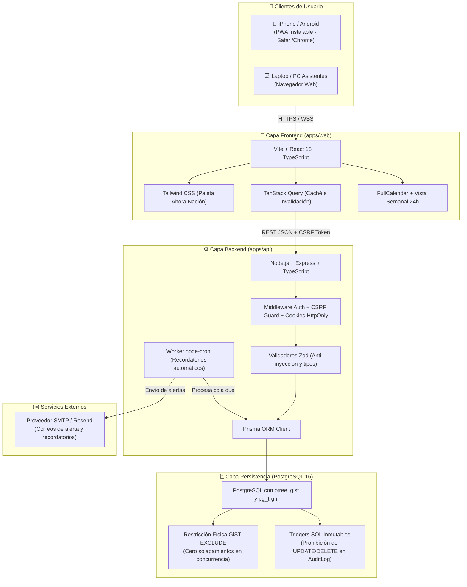
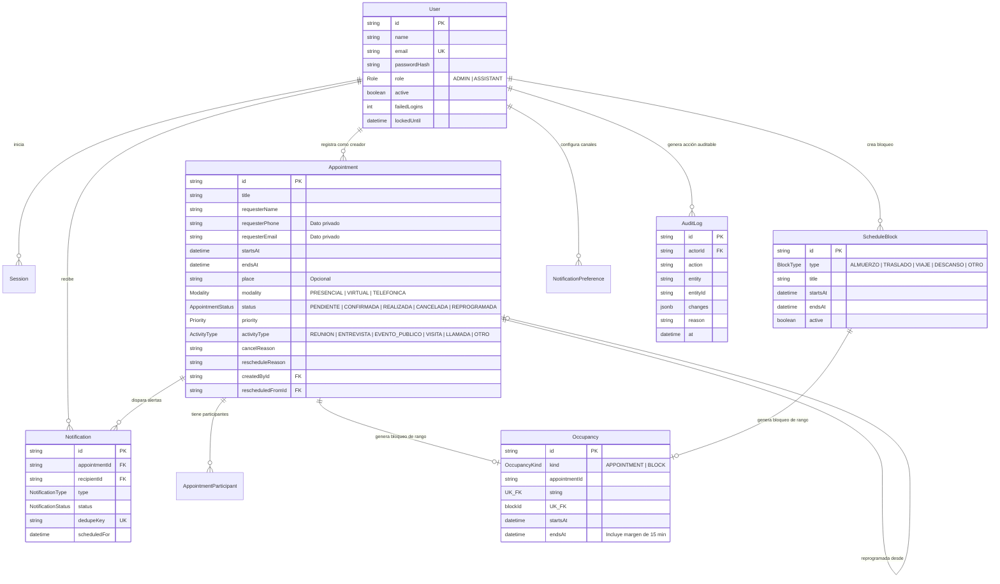
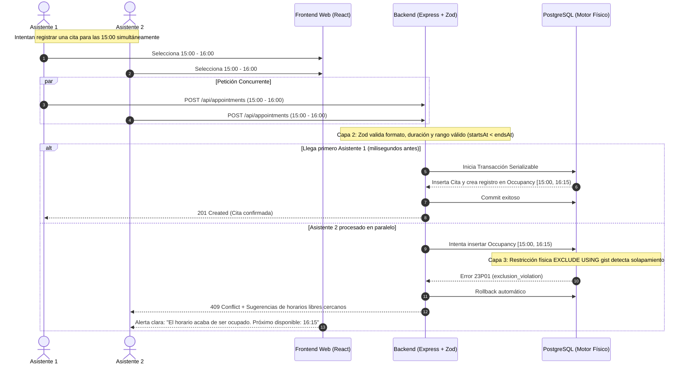

# Arquitectura del Sistema - Agenda Ahora Nación

Este documento describe en detalle la arquitectura técnica, modelo de datos, mecanismos de concurrencia y seguridad del **Sistema Web de Gestión de Agenda y Citas para el Candidato (Ahora Nación)**.

---

## 1. Diagrama de Arquitectura General (C4 - Nivel Contenedor)



---

## 2. Modelo de Datos y Esquema Relacional

El sistema está modelado bajo principios de normalización, estricto control de tipos y trazabilidad inmutable.



---

## 3. Prevención de Conflictos y Concurrencia (3 Capas)

Uno de los mayores retos de una agenda política es evitar que múltiples asistentes registren o reprogramen compromisos a la misma hora simultáneamente.



---

## 4. Estrategia de Seguridad y Privacidad

1. **Ley de Protección de Datos Personales (Ley 29733 - Perú):**
   - El equipo de campaña necesita coordinar sin chocarse en horas, pero no todos los asistentes deben tener acceso irrestricto a teléfonos o datos personales de fuentes reservadas o dignatarios.
   - **Regla de negocio en API:** Si un asistente consulta una cita que fue creada por otro usuario, los campos `requesterPhone` y `requesterEmail` son ofuscados (`[Privado]`). Solo el creador de la cita y el Administrador pueden ver los datos completos.
2. **Inmutabilidad de Auditoría:**
   - La tabla `AuditLog` tiene un trigger PostgreSQL que bloquea y rechaza de forma tajante cualquier intento de `UPDATE` o `DELETE`. Nadie puede borrar su rastro ni alterar el historial de cambios.
3. **Autenticación Resistente:**
   - Sesiones gestionadas vía cookies `HttpOnly`, `SameSite=Lax`, `Secure`.
   - Protección contra CSRF mediante token criptográfico en cabecera `X-CSRF-Token`.
   - Bloqueo de cuenta automático tras 5 intentos fallidos sucesivos durante 15 minutos.

---

## 5. Distribución de Componentes del Monorepo

```
Sistema Ahora Nacion/
├── apps/
│   ├── api/                     # Backend API REST
│   │   ├── prisma/
│   │   │   ├── schema.prisma    # Esquema declarativo Prisma
│   │   │   ├── migrations/      # Migraciones SQL con restricciones GiST y triggers
│   │   │   └── seed.ts          # Cuentas demo e inicialización
│   │   ├── src/
│   │   │   ├── auth/            # Middleware de sesión, CSRF, login, logout
│   │   │   ├── routes/          # Endpoints (/appointments, /blocks, /users, etc.)
│   │   │   ├── services/        # Lógica de negocio (notificaciones, solapamientos)
│   │   │   └── app.ts / server.ts
│   │   └── tests/               # 37 pruebas unitarias y de integración
│   └── web/                     # Frontend SPA & PWA
│       ├── public/
│       │   ├── icon.png         # Logo oficial Ahora Nación para iPhone / Android
│       │   ├── manifest.json    # Configuración PWA (instalación sin App Store)
│       │   └── logo-ahora-nacion.png
│       └── src/
│           ├── AppointmentForm.tsx    # Modal optimizado para móviles (sin cierre de teclado)
│           ├── WeeklyScheduleView.tsx # Horario semanal visual (verde libre, rojo cita, 24h)
│           ├── CalendarView.tsx       # FullCalendar interactivo
│           ├── DashboardView.tsx      # Panel principal resumen
│           └── LoginView.tsx          # Pantalla de acceso con identidad del partido
├── docs/
│   ├── arquitectura.md          # Esta especificación técnica
│   ├── modelo-datos.md          # Detalle entidad por entidad
│   ├── api.md                  # Especificación de endpoints REST
│   └── despliegue-y-riesgos.md # Guía para Supabase, Render y Vercel
├── docker-compose.yml          # PostgreSQL 16 para desarrollo local
├── package.json                # Workspaces de npm
└── README.md                   # Resumen del proyecto e instrucciones
```
