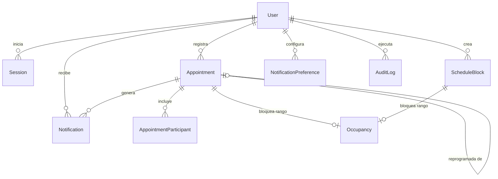

# Modelo de Datos y Esquema Relacional

## 1. Diagrama Entidad - Relación (Mermaid)



## 2. Entidades Principales

### `User`
- **id**: String (CUID, PK).
- **name**: String.
- **email**: String (Unique, Lowercase).
- **passwordHash**: String (bcrypt, cost factor configurable).
- **role**: Enum (`ADMIN`, `ASSISTANT`).
- **active**: Boolean (por defecto `true`).
- **failedLogins**: Integer (conteo de intentos fallidos consecutivos).
- **lockedUntil**: Timestamptz (bloqueo temporal tras 5 intentos fallidos).

### `Appointment`
- **id**: String (CUID, PK).
- **title**: String(200).
- **requesterName**: String(200).
- **requesterPhone**: String(20), opcional. Protegido por control de acceso.
- **requesterEmail**: String(200), opcional. Protegido por control de acceso.
- **description**: Text, opcional.
- **startsAt**: Timestamptz (instante UTC).
- **endsAt**: Timestamptz (instante UTC). Restricción `CHECK (endsAt > startsAt)`.
- **place**: String(300).
- **modality**: Enum (`PRESENCIAL`, `VIRTUAL`, `TELEFONICA`).
- **meetingUrl**: String(500), opcional.
- **status**: Enum (`PENDIENTE`, `CONFIRMADA`, `REALIZADA`, `CANCELADA`, `REPROGRAMADA`).
- **priority**: Enum (`BAJA`, `MEDIA`, `ALTA`, `URGENTE`).
- **activityType**: Enum (`REUNION`, `ENTREVISTA`, `EVENTO_PUBLICO`, `VISITA`, `LLAMADA`, `OTRO`).
- **notes**: Text, opcional.
- **createdById**: String (FK -> User).
- **rescheduledFromId**: String (FK -> Appointment), opcional.
- **cancelReason**: Text, obligatorio al cancelar.
- **rescheduleReason**: Text, obligatorio al reprogramar.

### `ScheduleBlock`
- **id**: String (CUID, PK).
- **type**: Enum (`ALMUERZO`, `TRASLADO`, `VIAJE`, `ACTIVIDAD_PUBLICA`, `DESCANSO`, `PERSONAL`, `DIA_NO_DISPONIBLE`).
- **title**: String(200).
- **startsAt**: Timestamptz.
- **endsAt**: Timestamptz. Restricción `CHECK (endsAt > startsAt)`.
- **active**: Boolean.
- **createdById**: String (FK -> User, solo administradores).

### `Occupancy` (Motor Central de Integridad y Concurrencia)
- **id**: String (CUID, PK).
- **kind**: Enum (`APPOINTMENT`, `BLOCK`).
- **appointmentId**: String (Unique, FK -> Appointment, Cascade).
- **blockId**: String (Unique, FK -> ScheduleBlock, Cascade).
- **startsAt**: Timestamptz.
- **endsAt**: Timestamptz (incluye margen de traslado si es cita).
- **Restricción EXCLUDE GiST**:
  ```sql
  CONSTRAINT occupancy_no_overlap
  EXCLUDE USING gist (tstzrange("startsAt", "endsAt", '[)') WITH &&)
  ```
  *Garantiza físicamente a nivel de motor PostgreSQL que bajo ninguna circunstancia concurrente se confirmen dos rangos solapados.*

### `Notification`
- **id**: String (CUID, PK).
- **appointmentId**: String (FK -> Appointment), opcional.
- **recipientId**: String (FK -> User).
- **type**: Enum (`CITA_CREADA`, `CITA_MODIFICADA`, `CITA_CANCELADA`, `CITA_REPROGRAMADA`, `RECORDATORIO`).
- **channel**: Enum (`EMAIL`, `WHATSAPP`).
- **status**: Enum (`PENDING`, `SENT`, `FAILED`).
- **attempts**: Integer.
- **scheduledFor**: Timestamptz.
- **dedupeKey**: String (Unique). Impide duplicados ante reintentos o ejecuciones simultáneas del worker.

### `AuditLog` (Inmutable)
- **id**: String (CUID, PK).
- **actorId**: String (FK -> User), opcional.
- **action**: String.
- **entity**: String.
- **entityId**: String.
- **changes**: JSONB (registra `{ campo: { de, a } }`).
- **reason**: Text, opcional.
- **at**: Timestamptz.
- *Trigger de base de datos prohíbe operaciones UPDATE y DELETE.*
